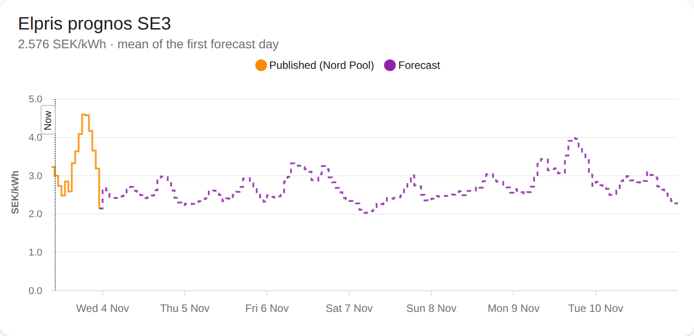

# Elprisprognos

A Home Assistant integration. It forecasts the Nordic spot price of electricity (SE1–SE4) for the next 7 days.

<picture>
  <source media="(prefers-color-scheme: dark)" srcset="docs/forecast_dark.png">
  
</picture>

## Install

1. In HACS, add the custom repository `https://github.com/AlexAsplund/ha-elprognos` (type: Integration).
   Or copy `custom_components/elprisprognos` to `config/custom_components/`.
2. Restart Home Assistant.
3. Go to **Settings → Devices & services** and add **Elprisprognos**.
4. Select the price area. Set the VAT (default 25 %) and the additional costs per kWh (grid fee, energy tax).

The first start downloads the price and weather history and trains the models. This takes some minutes.

## Sensors

| Entity | State | Attributes |
|---|---|---|
| `sensor.elpris_prognos_<area>` | Mean price of the first forecast day (SEK/kWh) | `forecast`: one row per hour |
| `sensor.elpris_prognos_<area>_status` | Model in use: `v2`, `ridge`, `error` or `starting` | Weather source, last fit, neighbour prices until, last problem |

Each row in `forecast` has these keys:

| Key | Value |
|---|---|
| `start` | Start of the hour |
| `spot` | Spot price (SEK/kWh) |
| `value` | spot × (1 + VAT) + additional costs |
| `forecast` | `false` = published price, `true` = forecast |

Use the attribute in charts or in automations that find the cheapest days.

<details>
<summary>The chart above as an <a href="https://github.com/RomRider/apexcharts-card">apexcharts-card</a></summary>

```yaml
type: custom:apexcharts-card
header: {show: true, title: Elpris prognos SE3, show_states: true}
graph_span: 8d
span: {start: hour}
now: {show: true, label: Now}
yaxis: [{min: 0, decimals: 1}]
series:
  - entity: sensor.elpris_prognos_se3
    name: Published (Nord Pool)
    type: line
    curve: stepline
    color: "#fb8c00"
    show: {in_header: false}
    data_generator: |
      return entity.attributes.forecast.filter(e => !e.forecast).map(e => [new Date(e.start).getTime(), e.value]);
  - entity: sensor.elpris_prognos_se3
    name: Forecast
    type: line
    curve: stepline
    color: "#8e24aa"
    stroke_dash: 5
    data_generator: |
      return entity.attributes.forecast.filter(e => e.forecast).map(e => [new Date(e.start).getTime(), e.value]);
```
</details>

## Accuracy

Backtest on SE3: 40 forecasts over one year, days 2–7 ahead.

| Method | Mean error (öre/kWh) |
|---|---|
| **v2 model** | **19.9** |
| v1 ridge model | 25.0 |
| Same hour last week | 40–41 |
| 7-day mean | 40–41 |

The daily mean prices correlate 0.88 with the real prices. Days 5–7 are a little optimistic, because the training uses archived short-lead weather forecasts.

## How it works

The forecast updates every hour. The models train again each day after 02:00.

**Data.** No API keys are necessary.

| Data | Source |
|---|---|
| Swedish prices (from 2022-11) | elprisetjustnu.se |
| Neighbour prices (DE-LU, DK1, FI, NO1, NO2) | energy-charts.info, or ENTSO-E with an optional token |
| Weather: wind, temperature, sun | Open-Meteo. If it is not available: MET Norway |
| Reactor and transmission outages | Nord Pool UMM |

**Model (v2).** Gradient-boosted trees, in two stages:

1. One model for each neighbour zone forecasts the price of that zone.
2. One model forecasts the Swedish price. It uses the neighbour forecasts, the weather, the calendar, the recent price levels and the outages.

The training uses only the data that was known when each forecast was made. If the neighbour prices are not available, the integration uses the v1 ridge model and logs a warning.

**Resources.** One training run takes approximately 2 minutes on one desktop CPU core and 0.5 GB RAM. A Raspberry Pi is slower. To make it faster, decrease `ROUNDS` or `LEADS` in `prognos.py`.

**Storage.** The models, the data and the last forecast are in `.storage/elprisprognos/`. After a restart, the sensor shows the last forecast immediately.

**Price areas.** The model is tuned on SE3. SE1, SE2 and SE4 use the same inputs.

## Scripts

| Command | Function |
|---|---|
| `python3 run.py backtest` | Makes the backtest above again. `WORKERS=n` runs it in parallel. |
| `python3 savings.py` | Simulates one year of EV charging with different strategies. |
| `python3 run.py publish` | Sends the forecast to Home Assistant through the REST API, without the integration. Set `HA_URL` and `HA_ACCESS_TOKEN`. |

## Tests

```
uv run --python 3.13 --with pytest-homeassistant-custom-component --with numpy pytest -q
```

## Licences

- energy-charts.info: private and internal use only. Each installation gets the data for its owner. The integration does not distribute it. If this is not applicable to you, use the ENTSO-E token.
- Open-Meteo and MET Norway: CC BY 4.0.
- Nord Pool UMM and ENTSO-E: the terms of the provider.
